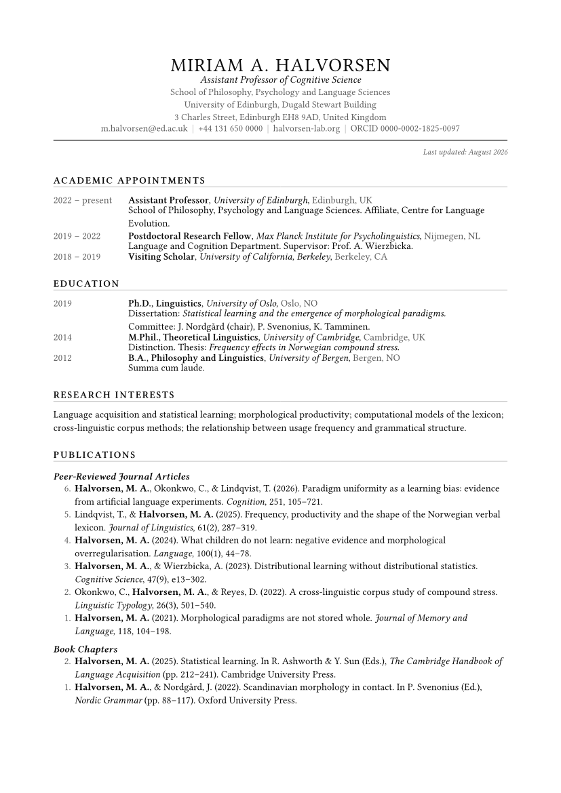

# academic-cv

A black-and-white academic curriculum vitae for [Typst](https://typst.app),
built for documents that run to five, ten, or thirty pages rather than one.

Strictly monochrome: emphasis comes from weight, size, spacing, and hairline
rules — never from colour. It prints and photocopies exactly as it appears on
screen, which is what search committees actually receive.

<p align="center">
  
</p>

<p align="center"><a href="preview.pdf">Full multi-page PDF sample</a></p>

**What it handles that a one-page résumé template does not:**

- A running header from page two onward — your name and `3 of 11`.
- Dated entries that align on a single axis down the entire document.
- Numbered publication lists with hanging indents, numbered *descending* so the
  newest work carries the highest number and existing numbers never shift.
- Your own name marked consistently through long author lists.
- Section headings and entry titles that are `sticky`: neither is ever stranded
  alone at the foot of a page.

```typst
#import "@preview/academic-cv:0.1.0": *

#show: cv.with(
  name: "Miriam A. Halvorsen",
  title: "Assistant Professor of Cognitive Science",
  address: (
    [School of Philosophy, Psychology and Language Sciences],
    [University of Edinburgh, Dugald Stewart Building],
  ),
  contacts: ([m.halvorsen\@ed.ac.uk], [+44 131 650 0000], [ORCID 0000-0002-1825-0097]),
)

= Academic Appointments

#entry(
  date: "2022 – present",
  title: "Assistant Professor",
  org: "University of Edinburgh",
  location: "Edinburgh, UK",
)[
  Affiliate, Centre for Language Evolution.
]

= Publications

#publications(
  [#me[Halvorsen, M. A.], & Okonkwo, C. (2026). Paradigm uniformity as a
   learning bias. _Cognition_, 251, 105–721.],
  [#me[Halvorsen, M. A.] (2024). What children do not learn. _Language_,
   100(1), 44–78.],
)
```

## Getting started

**As a local file.** Put `lib.typ` next to your CV:

```typst
#import "lib.typ": *
```

**As a local package.** Copy the folder into your Typst package directory and
import it as `@local/academic-cv:0.1.0`:

| Platform | Path |
| --- | --- |
| Linux | `~/.local/share/typst/packages/local/academic-cv/0.1.0` |
| macOS | `~/Library/Application Support/typst/packages/local/academic-cv/0.1.0` |
| Windows | `%APPDATA%\typst\packages\local\academic-cv\0.1.0` |

Then `typst watch main.typ` while you edit.

## The layout

Two columns run the length of the document. Dates sit in a fixed 24 mm left
column; everything else flows in the wider right column. Because the width is
fixed rather than sized to content, an appointment on page 1 and a committee
membership on page 9 line up on the same axis.

Publication lists deliberately break that grid — they start at the left margin
and use their own hanging indent, so a bibliography reads as a bibliography
rather than as more dated rows.

If you prefer dates on the right, set `date-position: "right"` and every dated
row in the document flips.

## `cv(..)` options

Only `name` is required.

### Identity

| Option | Default | What it does |
| --- | --- | --- |
| `name` | `"Your Name"` | Masthead; also sets the PDF title, author, and the running header. |
| `title` | `none` | Your rank or position, in italic under the name. |
| `address` | `none` | Content, or an array of lines rendered one per line. |
| `contacts` | `()` | Array of content, joined on one line with `\|` separators. |
| `updated` | `auto` | "Last updated" line, right-aligned under the rule. `auto` uses today's date; `none` omits it. |

### Typography

| Option | Default | What it does |
| --- | --- | --- |
| `font` | Libertinus Serif → EB Garamond → TeX Gyre Pagella → Charter → Termes → Georgia → DejaVu Serif | First available family wins. |
| `size` | `10.5pt` | `10pt`–`11pt` is the useful range. |
| `leading` | `0.68em` | Line spacing. |
| `justify` | `false` | Justified body text. |
| `lang` | `"en"` | Hyphenation and quote marks. |

### Palette (greys only)

| Option | Default | What it does |
| --- | --- | --- |
| `ink` | `luma(10)` | Body text. Use `black` for maximum contrast. |
| `muted` | `luma(95)` | Dates, addresses, field labels. |
| `rule` | `luma(160)` | Hairlines under section headings and the header. |

Raising `muted` toward `luma(120)` pushes the dates further back; dropping it to
`luma(60)` brings them forward. That single value controls most of how busy the
page feels.

### Page and layout

| Option | Default | What it does |
| --- | --- | --- |
| `paper` | `"a4"` | `"us-letter"` for the US. |
| `margin` | `(top: 22mm, bottom: 20mm, x: 20mm)` | The top margin leaves room for the running header. |
| `date-position` | `"left"` | `"left"` (academic convention) or `"right"`. |
| `date-width` | `24mm` | Width of the date column. Widen to `30mm` for dates like "September 2024". |
| `gutter` | `1.1em` | Space between the date column and the content. |

### Looks

| Option | Default | What it does |
| --- | --- | --- |
| `header-align` | `center` | `center` or `left` for the masthead. |
| `name-size` | `20pt` | |
| `name-weight` | `400` | Letterspaced caps read better at regular weight than bold. |
| `name-tracking` | `0.06em` | |
| `name-case` | `"upper"` | `"upper"` or `"normal"`. |
| `section-style` | `"rule"` | `"rule"` (caps + hairline), `"plain"` (caps only), `"smallcaps"` (true small caps, if your font has them). |
| `me-style` | `"bold"` | How `me()` marks your name: `"bold"`, `"underline"`, `"italic"`, `"none"`. |
| `running-header` | `auto` | `auto` prints `NAME … 3 of 11` from page two. `none` removes it, or pass your own content. |
| `page-numbers` | `true` | Page numbers within the running header. |

## Content functions

### Sections

Write `= Publications` and `== Journal Articles` — the template styles headings
directly. `#section[..]` and `#subsection[..]` are equivalent if you prefer
function calls. Because headings are real headings, the PDF gets proper
bookmarks for free.

### `entry(..)`

An appointment, degree, grant, award, or course.

```typst
#entry(
  date: "2019",
  title: "Ph.D., Linguistics",
  org: "University of Oslo",
  location: "Oslo, NO",
  compact: true,        // tighter spacing, for dense lists
)[
  Dissertation: _Statistical learning and morphological paradigms._
]
```

`title` is bold, `org` italic, `location` grey — all on one line, comma
separated, with the body beneath. Every field is optional.

### `publications(..)`

```typst
#publications(
  [Newest item …],
  [Older item …],
  style: "descending",   // "descending" | "ascending" | "bullet" | "plain"
  start: none,           // override the first number
  marker-width: 1.6em,
  spacing: 0.62em,
)
```

- `"descending"` (default) numbers newest-highest, matching the reverse
  chronological order the list is written in.
- `"ascending"` numbers 1, 2, 3 from the top.
- `"bullet"` for manuscripts under review, where numbering implies more than you
  want to claim.
- `"plain"` for no marker at all; combine with `hanging()` for conference
  presentations.

Use `start:` to continue numbering across a section split — if journal articles
end at 12 and you want book chapters to carry on, pass `start: 20` with
`"descending"` for a list of eight.

### Other pieces

| Function | Result |
| --- | --- |
| `#me[Halvorsen, M. A.]` | Your name in an author list, marked per `me-style`. |
| `#dated("2025")[..]` | A raw dated row — anything in the content column. |
| `#hanging[..]` | Hanging-indent paragraph, for talks and posters. |
| `#field("Reviewing", [..])` | A labelled row using the same two columns. |
| `#fields((..), (..))` | Several labelled rows at once. |
| `#note[(in press)]` | Small grey italic aside. |
| `#hr()` | Full-width hairline. |
| `#gap(amount: 1em)` | Vertical space. |

Talks are usually clearest as dated groups of hanging paragraphs:

```typst
#dated("2026")[
  #hanging[_Why paradigms survive._ Colloquium, MIT, Cambridge, MA. March.]
  #hanging[_Learning without rules._ Utrecht University, NL. January.]
]
```

## Fonts

The default stack degrades gracefully, but the CV looks best in
[Libertinus Serif](https://github.com/alerque/libertinus) or EB Garamond, both
free. TeX Gyre Pagella (a Palatino clone) ships with most TeX distributions and
is an excellent third choice. Run `typst fonts` to see what you have; Typst
warns about families it cannot find, and the warnings are harmless.

For real small caps in section headings — a nicer look than letterspaced
capitals — use a font with an `smcp` table and set
`section-style: "smallcaps"`. Libertinus Serif has one; most system fonts do
not, which is why letterspaced capitals are the default.

## A note on length

Academic CVs are not résumés and are not meant to fit on a page. Let the
document run. What matters is that it is skimmable: consistent dates in a fixed
column, sections in a predictable order, and publications numbered so a reader
can count them without doing so by hand.

## Licence

MIT.
